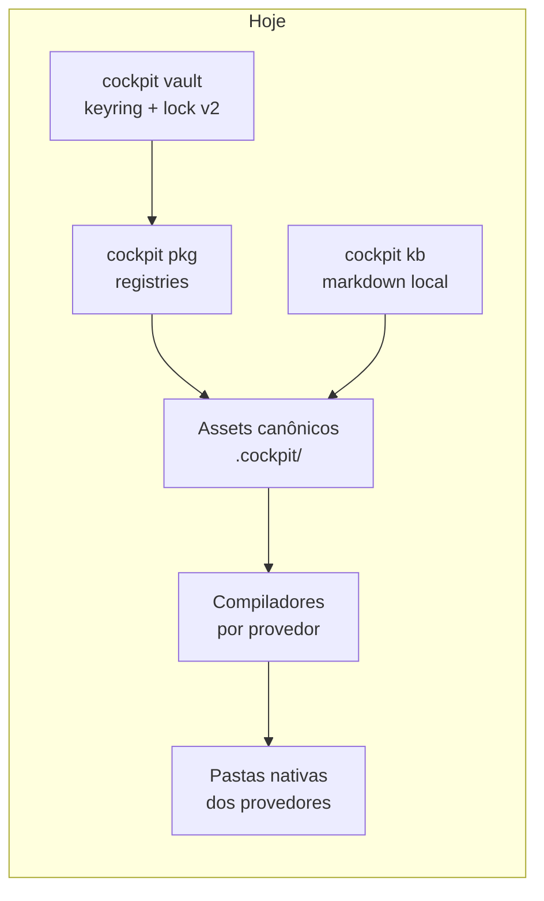

# Visão de produto do AICockpit

Estado: direção acordada com o dono do projeto. A fase 1 está implementada
em `internal/memory`. As demais fases deste roteiro ainda não estão
implementadas. A seção [Papel atual](#papel-atual) descreve o que o
código faz hoje.

Planos como o [P0-02](plans/p0-02-vault-state-implementation-plan.md) apontam
para este documento. O arquivo `docs/plans/user-harness-roadmap.md` não está
no repositório; o roteiro por fases abaixo é a referência.

## Papel atual

O AICockpit é infraestrutura compartilhada de harness para agentes de IA na
máquina local. O binário `cockpit` (Cobra, Go 1.26+) concentra quatro peças
que os provedores reutilizam, em vez de cada agente reinventar o seu próprio
conjunto de regras, segredos e documentos.

* **Compiladores por provedor** (`internal/providers`). Regras, skills,
  workflows, permissões e agentes canônicos são escritos uma vez e compilados
  para o formato de cada provedor. Os compiladores no código hoje são
  `antigravity`, `devin`, `goose`, `codex`, `github-copilot` e o compilador
  YAML genérico. `cockpit deploy` publica esses assets. A política canônica
  mora em `permissions.yaml` (`allowed_commands`, `denied_commands`,
  `allowed_dirs`, e os campos `allow` / `deny` / `ask`).
* **Pacotes e registries** (`internal/packages`, `cockpit pkg`). Instalação,
  busca, upgrade e registries Git com `package-index.yaml`. Pacotes podem
  registrar extensões de KB em `extensions.kb.search` e `extensions.kb.index`,
  executadas por `internal/kb`.
* **Vault** (`internal/vault`, `cockpit vault`). Credenciais no keyring do
  sistema operacional e estado de bloqueio v2 (AES-GCM, chave aleatória no
  serviço interno `aicockpit-internal`, migração explícita, falha fechada).
  O índice está em [docs/vault/README.md](vault/README.md). Perfis de pacote
  (`cockpit config`) guardam valores públicos em disco e referências a
  segredos no vault. Namespace é prefixo de armazenamento e fronteira da CLI,
  não sandbox do sistema operacional.
* **Knowledge base local** (`internal/kb`, `cockpit kb`). Markdown com
  frontmatter, índice, busca e grafo, em uma ou mais raízes. É a memória de
  longo prazo disponível hoje: documentos que o operador e os agentes
  consultam, não um serviço de memória com retenção própria.
* **Memória** (`internal/memory`, `internal/hindsight`). Contrato `Retain`,
  `Recall` e `Reflect` sobre o KB local. `cockpit memory up`, `down` e
  `status` administram um Hindsight local opcional (imagem Docker oficial,
  pg0, portas 8888 e 9999). Segredos saem do vault só como ambiente do
  container. Não há cliente Hindsight no core nem integração com o KB ou
  com os compiladores.

`cockpit doctor` verifica a existência de diretórios e arquivos locais
(configuração, vault, logs, pacotes, cache) e reporta o Hindsight. Sem
`memory.hindsight.enabled`, esse check é informativo e não reprova o doctor.
Não há fila de ferramentas nem orquestração de CLIs de modelo.

Assets como `cockpit-builder` são instruções compiladas para os provedores.
Não existe serviço executável `cockpit agent`. Comandos dessa forma citados
em guias antigos estão marcados como planejados e apontam para o
[roteiro](#roteiro-por-fases). O índice de comandos em
[docs/commands/README.md](commands/README.md) registra o mesmo status.

## Direção acordada

O cockpit passa a ser um agente assistente. Ele conduz o trabalho e delega a
execução a workers, com dois modos sob a mesma interface:

1. **CLIs locais como workers.** O assistente invoca os binários já instalados
   na máquina: `claude -p`, `codex exec`, `gemini -p` e `copilot`.
2. **APIs dos provedores.** O assistente chama a API correspondente com o
   token lido do vault. O token não aparece em argv, log ou telemetria.

O compilador continua publicando regras e skills nas pastas nativas. O
assistente é outra camada: ele escolhe um worker, mantém a sessão e aplica as
ferramentas. Compilar o adapter Codex, por exemplo, continua diferente de
executar `codex exec`.

## Memória

A memória do assistente entra por uma interface Go em `internal/memory`.
A primeira implementação usa o KB local: gravar, buscar e recuperar contexto
a partir dos documentos já indexados. Pacotes e o futuro `cockpit ask`
dependem dessa interface. O fornecedor concreto fica atrás do backend.

### Hindsight como serviço opcional

[Hindsight](https://github.com/vectorize-io/hindsight) é o serviço externo
opcional de memória. Características usadas nesta decisão:

| Aspecto | Valor |
|---|---|
| Repositório | https://github.com/vectorize-io/hindsight |
| Licença | MIT |
| Stack | Python e Postgres |
| Acesso | MCP, um servidor por *bank* |
| Cliente | biblioteca Go |

O Hindsight permanece um processo que `cockpit memory up` administra fora da
árvore de módulos Go, com a imagem oficial e o Postgres embutido (pg0). O
código Python e o Postgres dele não são copiados para este repositório, não
entram em `vendor/` e não viram um pacote embutido no binário. O cockpit ainda
não fala com ele pela interface `internal/memory`: o pacote
`memory-hindsight`, as extensões de KB e o MCP de cada bank continuam nas
fases seguintes. Sem o serviço, o backend de KB local continua válido.

## Roteiro por fases

Cada fase entrega um contrato testável e deixa as seguintes intactas. Nomes
de pacotes e de comandos abaixo são o alvo do desenho; nenhum deles existe na
CLI atual.

| Fase | Entrega | Resultado |
|---|---|---|
| 1 | Interface `internal/memory` | Contrato de memória com backend no KB local. Sem rede e sem Hindsight. |
| 2 | `cockpit memory up`, `down`, `status` e check no `cockpit doctor` | A CLI sobe e derruba o container oficial do Hindsight (portas 8888 e 9999, pg0, segredo do vault só no ambiente do container). O doctor reporta a saúde e não falha quando o serviço não está configurado. Sem extensão de KB e sem MCP. |
| 3 | Pacote `memory-hindsight` | Estende `kb search` e `kb index` pelas chaves `extensions.kb.search` e `extensions.kb.index`. `memory up` passa a poder subir o serviço externo. O código do Hindsight continua fora do repositório. |
| 4 | Compiladores injetam o MCP do Hindsight | Cada bank configurado vira um servidor MCP declarado aos provedores que já recebem skills e MCP. Sem bank, os compiladores não inventam um endpoint. |
| 5 | `internal/agents` com `Backend` e `CLIBackend` | Interface única de worker. `CLIBackend` executa `claude -p`, `codex exec`, `gemini -p` e `copilot`, com timeout, cancelamento e captura de saída. |
| 6 | `APIBackend` | O mesmo `Backend` chama a API do provedor com o token do vault. Falha de vault fechado ou token ausente nega a chamada. |
| 7 | `cockpit ask` | Entrada do assistente: uma pergunta ou tarefa escolhe um `Backend` e devolve a resposta. Ainda sem laço de ferramentas. |
| 8 | Tool loop | Laço de ferramentas com MCP, guardrails lidos de `permissions.yaml` e sessões persistidas. Comando negado pela política não executa. |
| 9 | Router | Escolhe worker, modo CLI ou API e modelo conforme a tarefa, a disponibilidade local e a política. O chamador ainda pode fixar o backend. |
| 10 | Daemon, rotinas e canais | Processo residente, rotinas agendadas e canais de entrada para o mesmo `cockpit ask`. Os canais concretos entram quando houver um desenho próprio. |

### Fase 1 — Interface de memória

Implementada em `internal/memory`. A interface `Memory` expõe `Retain`,
`Recall` e `Reflect`, com contexto cancelável e erros embrulhados. O backend
`KB` lê e escreve no KB local por meio de `internal/kb`: `Recall` usa a busca
do KB e `Retain` grava um markdown em `memory/<bank>/<id>.md` na primeira
raiz. `Reflect` agrega os trechos encontrados; um backend sem síntese pode
devolver `ErrReflectNotSupported`. `InMemory` e o dublê `Fake` cobrem testes
sem disco. Nenhum import de cliente Hindsight entra no core. Um backend
Hindsight futuro implementa a mesma interface fora deste pacote.

### Fase 2 — Ciclo de vida e doctor

Implementada em `internal/hindsight` e nos comandos `cockpit memory`.
`memory status` informa se o Hindsight está configurado, se o container está
em execução e se `GET /health` na porta 8888 responde. `memory up` cria o
container da imagem `ghcr.io/vectorize-io/hindsight:latest` (portas de host
8888 e 9999, volume nomeado em `/home/hindsight/.pg0`, sem
`HINDSIGHT_API_DATABASE_URL`, portanto pg0 embutido). `memory down` para e
remove o container e mantém o volume. A chave de LLM e os demais segredos
saem do vault no momento da criação e entram só como variáveis de ambiente;
não são gravados na configuração nem em logs. Docker é uma interface com
dublê de teste. `cockpit doctor` inclui o mesmo status em texto e JSON. Sem
`memory.hindsight.enabled`, o check fica `skipped` e não reprova o doctor.
O backend de KB da fase 1 não muda.

### Fase 3 — Pacote memory-hindsight

O pacote vive no registry, como os demais, e implementa as extensões de busca
e indexação que `internal/kb` já percorre. A configuração guarda URL, bank e
referência ao segredo no vault. `memory up` já lança o container; esta fase
liga o serviço às extensões. Desinstalar o pacote devolve a busca ao BM25 do KB.

### Fase 4 — MCP nos compiladores

Os compiladores passam a emitir a entrada MCP do bank Hindsight junto dos
assets canônicos, no formato que cada provedor já aceita para MCP. O endpoint
vem da configuração do pacote. Um provedor sem suporte a MCP registra a
limitação no lugar de gravar um arquivo inválido. O caso do GitHub Copilot,
que já recusa uma tradução fiel de `permissions.yaml`, continua explícito.

### Fase 5 — Backend de CLI

`internal/agents.Backend` é a porta de um worker: iniciar uma conversa,
enviar um turno, cancelar e ler o estado. `CLIBackend` configura o executável,
os argumentos base (`claude -p`, `codex exec`, `gemini -p`, `copilot`) e o
ambiente. Segredos só entram se a fase 6 ou um `cockpit config exec` já os
tiver injetado de propósito. Testes usam um binário falso.

### Fase 6 — Backend de API

`APIBackend` implementa o mesmo `Backend` com o cliente HTTP do provedor. O
token sai do vault no momento da chamada, pelo namespace autorizado, e não é
ecoado em erro. Provedor sem token configurado retorna erro antes do request.

### Fase 7 — cockpit ask

`cockpit ask` é o comando do assistente. Ele exige um backend disponível,
grava a troca na sessão quando a fase 8 existir e, até lá, executa um turno.
A saída humana e a saída JSON compartilham o mesmo resultado. Este comando é
o sucessor planejado da ideia antiga de `cockpit agent run`.

### Fase 8 — Laço de ferramentas

O laço permite ao worker pedir ferramentas. Ferramentas MCP entram pela
configuração injetada na fase 4 e por servidores declarados na sessão. Antes
de executar um comando ou um caminho, o laço consulta `permissions.yaml` no
mesmo formato que os compiladores já leem. Negação, pergunta (`ask`) e
diretório fora de `allowed_dirs` interrompem a ferramenta e registram o
motivo. Sessões guardam histórico, backend e grants usados, em diretório
privado sob `~/.cockpit/`.

### Fase 9 — Router

O router implementa a escolha que `cockpit ask` usa quando a pessoa não fixa
o worker. A decisão considera binário presente no `PATH`, token no vault,
política do projeto e o pedido. A escolha fica na sessão para auditoria. Um
flag explícito de backend continua tendo prioridade.

### Fase 10 — Daemon, rotinas e canais

Um daemon reutiliza `ask`, o router e as sessões para trabalho que não cabe
num único processo de terminal: rotinas com agenda e canais que entregam uma
mensagem e recebem a resposta. A definição de cada canal (transporte, autenticação,
permissão) é um desenho separado desta visão. O daemon observa o mesmo estado
de lock do vault; vault fechado recusa rotinas que leiam segredo.

## Leitura relacionada

* [01. Visão geral da arquitetura](architecture/01-overview.md)
* [02. Compiladores e provedores](architecture/02-provider-compilers.md)
* [04. Registries](architecture/04-package-registries.md)
* [05. Vault](architecture/05-vault-system.md) e o [índice do vault](vault/README.md)
* [06. Knowledge base](architecture/06-knowledge-base.md)
* [Índice de comandos](commands/README.md)
* [Perfis de pacote](plans/package-profiles.md)
* [Hindsight](https://github.com/vectorize-io/hindsight)
