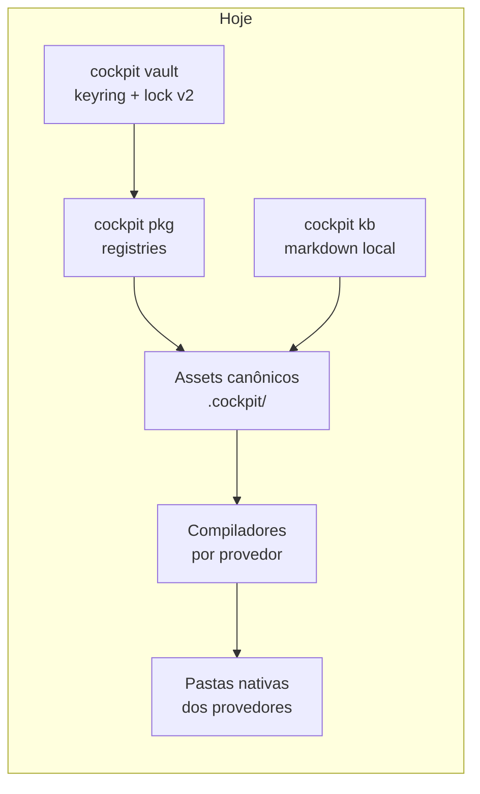
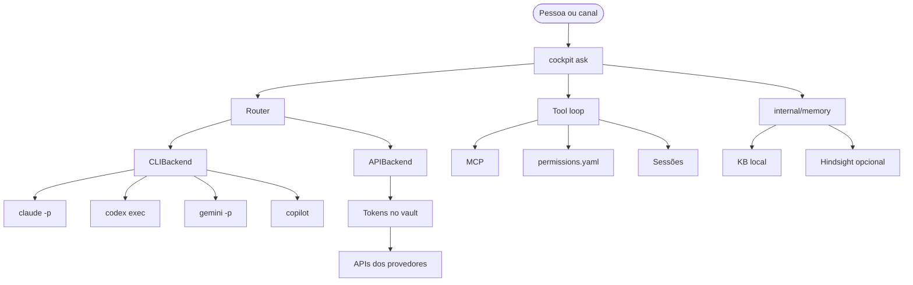

# Visão de produto do AICockpit

Estado: direção acordada com o dono do projeto. As fases 1 a 4 estão
implementadas em `internal/memory`, `internal/hindsight`,
`internal/memoryhindsight` e `internal/providers`. A fase 5 está
implementada em `internal/agents` para as CLIs `claude` e `codex`. As fases
6 em diante deste roteiro ainda não estão implementadas. A seção
[Papel atual](#papel-atual) descreve o que o código faz hoje.

Planos como o [P0-02](plans/p0-02-vault-state-implementation-plan.md) apontam
para este documento. O arquivo `docs/plans/user-harness-roadmap.md` não está
no repositório; o roteiro por fases abaixo é a referência.

## Papel atual

O AICockpit é infraestrutura compartilhada de harness para agentes de IA na
máquina local. O binário `cockpit` (Cobra, Go 1.26+) concentra quatro peças
que os provedores reutilizam, em vez de cada agente reinventar o seu próprio
conjunto de regras, segredos e documentos.



* **Compiladores por provedor** (`internal/providers`). Regras, skills,
  workflows, permissões e agentes canônicos são escritos uma vez e compilados
  para o formato de cada provedor. Os compiladores no código hoje são
  `antigravity`, `devin`, `goose`, `codex`, `github-copilot` e o compilador
  YAML genérico. `cockpit deploy` publica esses assets. A política canônica
  mora em `permissions.yaml` (`allowed_commands`, `denied_commands`,
  `allowed_dirs`, e os campos `allow` / `deny` / `ask`).
* **Pacotes e registries** (`internal/packages`, `cockpit pkg`). Instalação,
  busca, upgrade e registries Git com `package-index.yaml`. Pacotes podem
  registrar extensões de KB em `extensions.kb.search` e `extensions.kb.index`,
  executadas por `internal/kb`.
* **Vault** (`internal/vault`, `cockpit vault`). Credenciais no keyring do
  sistema operacional e estado de bloqueio v2 (AES-GCM, chave aleatória no
  serviço interno `aicockpit-internal`, migração explícita, falha fechada).
  O índice está em [docs/vault/README.md](vault/README.md). Perfis de pacote
  (`cockpit config`) guardam valores públicos em disco e referências a
  segredos no vault. Namespace é prefixo de armazenamento e fronteira da CLI,
  não sandbox do sistema operacional.
* **Knowledge base local** (`internal/kb`, `cockpit kb`). Markdown com
  frontmatter, índice, busca e grafo, em uma ou mais raízes. É a memória de
  longo prazo disponível hoje: documentos que o operador e os agentes
  consultam, não um serviço de memória com retenção própria.
* **Memória** (`internal/memory`, `internal/hindsight`,
  `internal/memoryhindsight`). Contrato `Retain`, `Recall` e `Reflect`.
  O backend padrão continua no KB local. `cockpit memory up`, `down` e
  `status` administram um Hindsight local opcional (imagem Docker oficial,
  pg0, portas 8888 e 9999). Segredos saem do vault só como ambiente do
  container. Com `memory.hindsight.enabled`, o cliente Go oficial entra
  pelos pontos de extensão do KB: `kb search` acrescenta o recall e
  `kb index` retém documentos. Há um bank por projeto e um por usuário.
  Serviço desligado ou inacessível deixa a busca no KB local. Com o mesmo
  flag, `cockpit deploy` declara o MCP HTTP de cada bank para Claude Code,
  Codex, Gemini CLI e GitHub Copilot CLI.

`cockpit doctor` verifica a existência de diretórios e arquivos locais
(configuração, vault, logs, pacotes, cache), reporta o Hindsight e informa
se as CLIs `claude` e `codex` estão instaladas e em qual versão. Sem
`memory.hindsight.enabled`, o check do Hindsight é informativo. CLI ausente
também não reprova o doctor. `internal/agents` executa uma tarefa em
`claude -p` ou `codex exec`. Não há comando `cockpit ask`, backend de API,
fila de ferramentas nem router.

Assets como `cockpit-builder` são instruções compiladas para os provedores.
Não existe serviço executável `cockpit agent`. Comandos dessa forma citados
em guias antigos estão marcados como planejados e apontam para o
[roteiro](#roteiro-por-fases). O índice de comandos em
[docs/commands/README.md](commands/README.md) registra o mesmo status.

## Direção acordada

O cockpit passa a ser um agente assistente. Ele conduz o trabalho e delega a
execução a workers, com dois modos sob a mesma interface:

1. **CLIs locais como workers.** O assistente invoca os binários já instalados
   na máquina: `claude -p`, `codex exec`, `gemini -p` e `copilot`.
2. **APIs dos provedores.** O assistente chama a API correspondente com o
   token lido do vault. O token não aparece em argv, log ou telemetria.

O compilador continua publicando regras e skills nas pastas nativas. O
assistente é outra camada: ele escolhe um worker, mantém a sessão e aplica as
ferramentas. Compilar o adapter Codex, por exemplo, continua diferente de
executar `codex exec`.



## Memória

A memória do assistente entra por uma interface Go em `internal/memory`.
A primeira implementação usa o KB local: gravar, buscar e recuperar contexto
a partir dos documentos já indexados. Pacotes e o futuro `cockpit ask`
dependem dessa interface. O fornecedor concreto fica atrás do backend.

### Hindsight como serviço opcional

[Hindsight](https://github.com/vectorize-io/hindsight) é o serviço externo
opcional de memória. Características usadas nesta decisão:

| Aspecto | Valor |
|---|---|
| Repositório | https://github.com/vectorize-io/hindsight |
| Licença | MIT |
| Stack | Python e Postgres |
| Acesso | MCP, um servidor por *bank* |
| Cliente | biblioteca Go |

O Hindsight permanece um processo que `cockpit memory up` administra fora da
árvore de módulos Go, com a imagem oficial e o Postgres embutido (pg0). O
código Python e o Postgres dele não são copiados para este repositório, não
entram em `vendor/` e não viram um pacote embutido no binário. `internal/memoryhindsight` fala com a API por HTTP usando o cliente Go
oficial, atrás de uma interface coberta por dublês. Sem o serviço, ou
quando ele não responde, o backend de KB local continua válido. O MCP de
cada bank é declarado pelos compiladores quando o serviço está habilitado.

## Roteiro por fases

Cada fase entrega um contrato testável e deixa as seguintes intactas. As
fases 1 a 4 estão no código. As fases 5 e 6 estão em `internal/agents`
(`CLIBackend` para `claude` e `codex`, `APIBackend` para as APIs), sem
comando novo. Os nomes das fases seguintes são o alvo do desenho e ainda
não existem na CLI.

| Fase | Entrega | Resultado |
|---|---|---|
| 1 | Interface `internal/memory` | Contrato de memória com backend no KB local. Sem rede e sem Hindsight. |
| 2 | `cockpit memory up`, `down`, `status` e check no `cockpit doctor` | A CLI sobe e derruba o container oficial do Hindsight (portas 8888 e 9999, pg0, segredo do vault só no ambiente do container). O doctor reporta a saúde e não falha quando o serviço não está configurado. Sem extensão de KB e sem MCP. |
| 3 | Integração `memory-hindsight` | Backend `memory.Memory` com o cliente Go oficial, atrás de uma interface de teste. `kb search` acrescenta o recall e `kb index` retém documentos em `RunSearchExtensions` e `RunIndexExtensions`. Um bank por projeto e um por usuário. Serviço desligado ou inacessível deixa só o KB local. O código do Hindsight continua fora do repositório. |
| 4 | Compiladores injetam o MCP do Hindsight | Cada bank configurado vira um servidor MCP declarado aos provedores que já recebem skills e MCP. Sem bank, os compiladores não inventam um endpoint. |
| 5 | `internal/agents` com `Backend` e `CLIBackend` | Interface única de worker para uma tarefa. `CLIBackend` executa `claude -p` (stream-json) e `codex exec` (JSONL), com timeout, cancelamento, diretório e modelo opcional. `gemini -p` e `copilot` ficam para depois. |
| 6 | `APIBackend` | O mesmo `Backend` chama a API do provedor com o token do vault. Anthropic Messages e Chat Completions compatível com OpenAI. Falha de vault fechado ou token ausente nega a chamada. Sem laço de ferramentas. |
| 7 | `cockpit ask` | Entrada do assistente: uma pergunta ou tarefa escolhe um `Backend` e devolve a resposta. Ainda sem laço de ferramentas. |
| 8 | Tool loop | Laço de ferramentas com MCP, guardrails lidos de `permissions.yaml` e sessões persistidas. Comando negado pela política não executa. |
| 9 | Router | Escolhe worker, modo CLI ou API e modelo conforme a tarefa, a disponibilidade local e a política. O chamador ainda pode fixar o backend. |
| 10 | Daemon, rotinas e canais | Processo residente, rotinas agendadas e canais de entrada para o mesmo `cockpit ask`. Os canais concretos entram quando houver um desenho próprio. |

### Fase 1 — Interface de memória

Implementada em `internal/memory`. A interface `Memory` expõe `Retain`,
`Recall` e `Reflect`, com contexto cancelável e erros embrulhados. O backend
`KB` lê e escreve no KB local por meio de `internal/kb`: `Recall` usa a busca
do KB e `Retain` grava um markdown em `memory/<bank>/<id>.md` na primeira
raiz. `Reflect` agrega os trechos encontrados; um backend sem síntese pode
devolver `ErrReflectNotSupported`. `InMemory` e o dublê `Fake` cobrem testes
sem disco. Nenhum import de cliente Hindsight entra no core. O backend
Hindsight vive em `internal/memoryhindsight` e implementa a mesma interface.

### Fase 2 — Ciclo de vida e doctor

Implementada em `internal/hindsight` e nos comandos `cockpit memory`.
`memory status` informa se o Hindsight está configurado, se o container está
em execução e se `GET /health` na porta 8888 responde. `memory up` cria o
container da imagem `ghcr.io/vectorize-io/hindsight:latest` (portas de host
8888 e 9999, volume nomeado em `/home/hindsight/.pg0`, sem
`HINDSIGHT_API_DATABASE_URL`, portanto pg0 embutido). `memory down` para e
remove o container e mantém o volume. A chave de LLM e os demais segredos
saem do vault no momento da criação e entram só como variáveis de ambiente;
não são gravados na configuração nem em logs. Docker é uma interface com
dublê de teste. `cockpit doctor` inclui o mesmo status em texto e JSON. Sem
`memory.hindsight.enabled`, o check fica `skipped` e não reprova o doctor.
O backend de KB da fase 1 não muda.

### Fase 3 — Integração memory-hindsight

Implementada em `internal/memoryhindsight`. O backend implementa
`memory.Memory` com o cliente Go oficial
(`github.com/vectorize-io/hindsight/hindsight-clients/go`). Os testes usam
um dublê e não abrem rede.

A integração é opcional e entra em `RunSearchExtensions` e
`RunIndexExtensions`, os mesmos pontos que executam
`extensions.kb.search` e `extensions.kb.index`. Com
`memory.hindsight.enabled`, `kb search` mantém o resultado local e
acrescenta o recall. `kb index` retém os documentos no bank do projeto.
A configuração guarda a URL (`memory.hindsight.api_url`, por omissão a
porta publicada por `memory up`), os banks e a referência
`api_token_name` no vault. Os nomes vazios viram `project-<nome>` e
`user-<nome>`.

Serviço desligado, mal configurado ou inacessível não falha a busca nem
a indexação: o comando avisa e fica só com o KB local. O código do
Hindsight continua fora deste repositório.

### Fase 4 — MCP nos compiladores

Implementada em `internal/providers`. Com `memory.hindsight.enabled`,
`cockpit deploy` grava um servidor MCP por bank nos provedores que
implementam `MCPCompiler`. O transporte é HTTP (streamable HTTP, não SSE)
em `{api}/mcp/{bank}/`, com barra no final. A base vem de
`memory.hindsight.api_url` ou, vazia, de `http://127.0.0.1:<api_port>`.
Os ids saem de `memoryhindsight.ResolveBanks`: o bank do projeto, onde
`kb index` retém documentos, e o bank do usuário, que o recall também lê.
Serviço desligado não cria endpoint. Bank inválido falha o deploy em vez
de inventar uma URL. O token do vault não é gravado no arquivo.

| Provedor | Arquivo | Forma |
|---|---|---|
| Claude Code (`claude`) | `.mcp.json` | `type: http` e `url` |
| Codex (`codex`) | `.codex/config.toml` | tabela `mcp_servers` com `url` |
| Gemini CLI (`gemini`) | `.gemini/settings.json` | `httpUrl` |
| GitHub Copilot CLI | `~/.copilot/mcp-config.json` | `type: http`, `url` e `tools` |

O provedor precisa estar em `enabled_providers`. A feature `mcp` pode ser
desligada nele. Desligar o Hindsight depois não apaga uma entrada já
gravada; os outros arquivos compilados seguem iguais ao deploy sem o
serviço.

Devin, Goose e Antigravity não recebem essa entrada. Nenhum dos três tem
um documento HTTP de MCP que o compilador possa preencher sem gravar um
arquivo que o agente ignora. O formato desses produtos fica para um
follow-up. O Gemini CLI não é o provider Antigravity. O GitHub Copilot
continua sem traduzir `permissions.yaml`.

### Fase 5 — Backend de CLI

Implementada em `internal/agents` para `claude` e `codex`. `Backend.Run`
recebe uma tarefa (prompt, diretório de trabalho, timeout e modelo opcional),
entrega eventos em fluxo e devolve o resultado final. Cancelar o contexto
encerra o subprocesso. `CLIBackend` fala com o binário por um `Runner`
injetável. Os testes leem fixtures do formato de saída e não invocam as CLIs
reais. Este pacote não acrescenta variáveis de ambiente e não lê o vault.

Os argumentos seguem a documentação atual de cada CLI:

* Claude Code headless: `claude -p --output-format stream-json --verbose --include-partial-messages`, com `--model` só quando a tarefa pede um modelo. O comando principal não tem flag de diretório; o processo usa o diretório da tarefa. `CLAUDECODE` e `CLAUDE_CODE_ENTRYPOINT` saem do ambiente herdado para um `claude` aninhado não recusar o arranque.
* Codex non-interactive: `codex exec --json --skip-git-repo-check`, com `--model` e `--cd` opcionais. `--skip-git-repo-check` existe porque a tarefa pode apontar para um diretório que não é um repositório Git. O sandbox não é alterado e permanece o padrão read-only da CLI.

`gemini -p`, `copilot` e `cockpit ask` continuam nas fases seguintes.
`cockpit doctor` reporta instalação e versão de `claude` e `codex`. A
ausência não reprova o doctor.

### Fase 6 — Backend de API

Implementada em `internal/agents`. `APIBackend` implementa o mesmo `Backend`
e faz uma completação simples, ainda sem laço de ferramentas. O token sai do
vault no momento da chamada, pelo namespace e pela chave configurados, e não
é ecoado em erro, log ou arquivo. Vault fechado ou token ausente recusa a
chamada antes do HTTP.

Dois clientes, ambos com streaming:

* Anthropic Messages (`provider: anthropic`), em `{base}/v1/messages`.
* Chat Completions compatível com OpenAI (`openai`, `ollama`, `lmstudio`,
  `openrouter`). A URL base escolhe o host; o payload é o mesmo
  `{base}/v1/chat/completions`.

```yaml
agents:
  api:
    provider: anthropic
    model: claude-sonnet-4-5
    base_url: https://api.anthropic.com
    vault_namespace: agents
    vault_key: anthropic_api_key
```

O valor do token fica no vault (`cockpit vault set --namespace agents anthropic_api_key`) e não entra neste arquivo. A omissão de `vault_namespace` usa `agents`. A omissão de `vault_key` usa `<provider>_api_key`. `ToolSpec` e `ToolCall` reservam o formato das ferramentas; `Run` não as envia e não as executa. Os testes injetam um `HTTPDoer` e usam `httptest`, sem rede.

`cockpit doctor` acrescenta uma linha por provedor conhecido. A linha diz se o token está configurado e nunca imprime o segredo. Token ausente ou vault fechado não reprova o doctor.

### Fase 7 — cockpit ask

`cockpit ask` é o comando do assistente. Ele exige um backend disponível,
grava a troca na sessão quando a fase 8 existir e, até lá, executa um turno.
A saída humana e a saída JSON compartilham o mesmo resultado. Este comando é
o sucessor planejado da ideia antiga de `cockpit agent run`.

### Fase 8 — Laço de ferramentas

O laço permite ao worker pedir ferramentas. Ferramentas MCP entram pela
configuração injetada na fase 4 e por servidores declarados na sessão. Antes
de executar um comando ou um caminho, o laço consulta `permissions.yaml` no
mesmo formato que os compiladores já leem. Negação, pergunta (`ask`) e
diretório fora de `allowed_dirs` interrompem a ferramenta e registram o
motivo. Sessões guardam histórico, backend e grants usados, em diretório
privado sob `~/.cockpit/`.

### Fase 9 — Router

O router implementa a escolha que `cockpit ask` usa quando a pessoa não fixa
o worker. A decisão considera binário presente no `PATH`, token no vault,
política do projeto e o pedido. A escolha fica na sessão para auditoria. Um
flag explícito de backend continua tendo prioridade.

### Fase 10 — Daemon, rotinas e canais

Um daemon reutiliza `ask`, o router e as sessões para trabalho que não cabe
num único processo de terminal: rotinas com agenda e canais que entregam uma
mensagem e recebem a resposta. A definição de cada canal (transporte, autenticação,
permissão) é um desenho separado desta visão. O daemon observa o mesmo estado
de lock do vault; vault fechado recusa rotinas que leiam segredo.

## Leitura relacionada

* [01. Visão geral da arquitetura](architecture/01-overview.md)
* [02. Compiladores e provedores](architecture/02-provider-compilers.md)
* [04. Registries](architecture/04-package-registries.md)
* [05. Vault](architecture/05-vault-system.md) e o [índice do vault](vault/README.md)
* [06. Knowledge base](architecture/06-knowledge-base.md)
* [Índice de comandos](commands/README.md)
* [Perfis de pacote](plans/package-profiles.md)
* [Hindsight](https://github.com/vectorize-io/hindsight)
