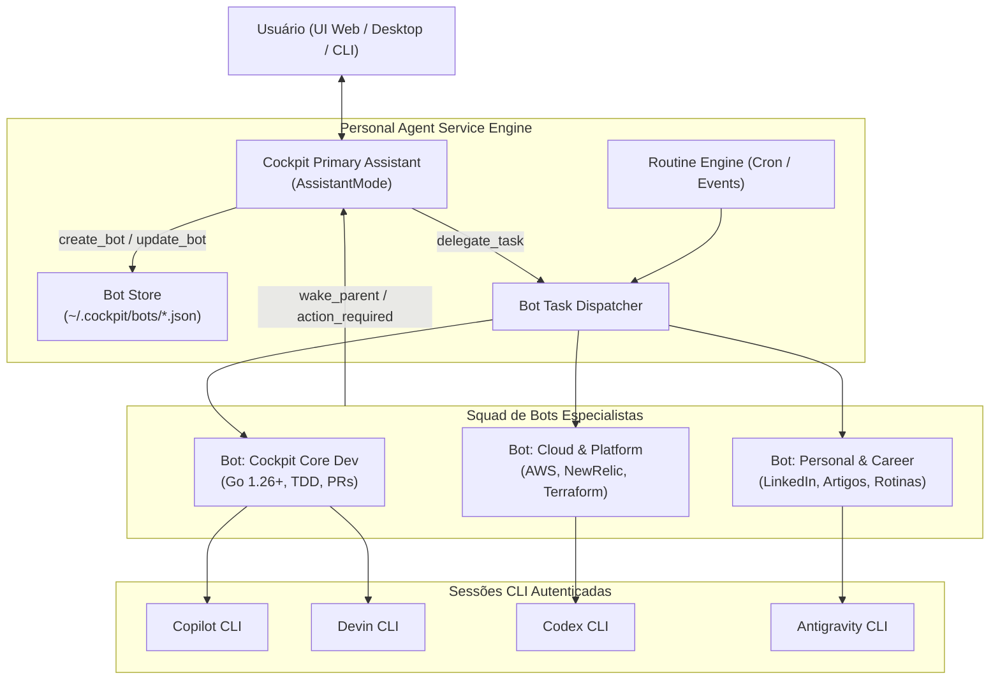

# Proposta de Arquitetura: Cockpit Multi-Bot Engine (Personal & Specialized Bots)

**Status:** Proposto  
**Data:** 2026-10-27  
**Autor:** Antigravity / Cockpit Evolution Squad  
**Projeto:** `cockpit-evolution` (`/home/lleite/projects/aicockpit`)  
**Documento Relacionado:** [FLOW-001-UC-001-cockpit-personal-agent.md](file:///home/lleite/projects/aicockpit/docs/plans/FLOW-001-UC-001-cockpit-personal-agent.md), [FLOW-002-UC-002-assistente-operacional-cockpit.md](file:///home/lleite/projects/aicockpit/docs/plans/FLOW-002-UC-002-assistente-operacional-cockpit.md)

---

## 1. Visão Geral e Motivação

O objetivo é transformar o **Cockpit Personal Agent** em um ecossistema multi-agente autônomo e extensível, inspirado no modelo do **Grok Bot (xAI/Cursor - codinome `sand`)**, permitindo que o Cockpit seja um **assistente pessoal e profissional que cria, supervisiona e delega tarefas para outros bots especialistas**.

Diferente de frameworks que exigem chaves de API pagas dedicadas (ex: LangChain / CrewAI vanilla), o Cockpit aproveita a infraestrutura já existente do harness:
1. **Providers CLI autenticados na máquina:** GitHub Copilot CLI, Devin CLI, Codex, Antigravity.
2. **Proxy de economia de tokens:** `rtk`.
3. **Memória de longo prazo e regras corporativas:** `cockpit kb`, `cockpit vault`, `AGENTS.md`.
4. **Governança e aprovação humana:** modelo `AssistantAction` / `ApprovalPolicy`.

---

## 2. Benchmark e Lições do Grok Bot (`sand` v0.75.8)

Engenharia reversa realizada diretamente no binário instalado na máquina (`/opt/Grok Bot/resources/app.asar`):
- **Primary Bot:** Interlocutor central que entende linguagem natural e instancia bots sob demanda.
- **Ferramentas de Meta-Orquestração:**
  - `CreateAgent`, `UpdateAgent`, `SetPrimaryBot`, `SearchBotTemplates`
  - `SendToAgent`, `ReadAgentActivity`, `MessageSubagent`, `StopSubagent`, `WakeParent`
  - `CreateTask`, `UpdateTask`, `ReadTask`
  - `RecallMemory`, `UpdateMemory`, `UpdateState`
- **Rotinas e Gatilhos:**
  - `UpdateRoutine` (agendamento cron ou eventos de sistema).
  - Pausa de segurança de rotinas ociosas para evitar consumo desnecessário de tokens.
- **Portões de Aprovação:**
  - Ferramentas sensíveis (`Shell`, `Vault`, commits, mensagens externas) requerem aceite explícito do usuário.

---

## 3. Arquitetura Proposta para o AICockpit



### 3.1. Novas Estruturas de Dados (`internal/personalagent/types.go`)

```go
type Bot struct {
    ID             string            `json:"id"`
    Name           string            `json:"name"`
    Handle         string            `json:"handle"` // ex: @cockpit-dev
    Description    string            `json:"description"`
    Avatar         string            `json:"avatar,omitempty"`
    Role           string            `json:"role"`
    Instructions   string            `json:"instructions"` // Persona & Prompt base
    ProjectID      string            `json:"project_id,omitempty"`
    Workspace      string            `json:"workspace,omitempty"`
    Selection      Selection         `json:"selection"` // Provider (Copilot/Devin/etc.) + Model
    Skills         []string          `json:"skills,omitempty"`
    KnowledgeBases []string          `json:"knowledge_bases,omitempty"`
    AllowedTools   []string          `json:"allowed_tools,omitempty"`
    ApprovalPolicy string            `json:"approval_policy"` // "always", "on-write", "never"
    CreatedAt      time.Time         `json:"created_at"`
    UpdatedAt      time.Time         `json:"updated_at"`
}

type BotRoutine struct {
    ID          string    `json:"id"`
    BotID       string    `json:"bot_id"`
    Name        string    `json:"name"`
    Schedule    string    `json:"schedule,omitempty"` // Expressão cron
    EventFilter string    `json:"event_filter,omitempty"` // ex: "git:push", "pr:opened"
    Prompt      string    `json:"prompt"`
    Status      string    `json:"status"` // "active", "paused", "disabled"
    LastRunAt   time.Time `json:"last_run_at,omitempty"`
}
```

### 3.2. Expansão das Ferramentas do Assistente Principal

Em [`internal/personalagent/service.go`](file:///home/lleite/projects/aicockpit/internal/personalagent/service.go), adicionar ao `AssistantMode`:
1. `create_bot`: Cria um novo bot especialista configurando persona, provider, modelo e diretrizes.
2. `list_bots`: Lista todos os bots cadastrados e seus status.
3. `update_bot`: Ajusta instruções, workspace ou ferramentas do bot.
4. `delegate_to_bot`: Dispara uma missão para um bot específico em sua própria thread/conversa de execução.
5. `read_bot_activity`: Obtém o andamento e outputs gerados por um bot especialista.

---

## 4. Fases de Implementação

1. **Fase 1 (Fundação de Bots):**
   - Implementar `BotStore` (`~/.cockpit/bots/`) e tipos em Go.
   - Adicionar ferramentas de gerenciamento de bots no `AssistantMode`.
   - Adicionar listagem e criação de bots na UI (`internal/personalagent/web`).
2. **Fase 2 (Delegação e Notificações Assíncronas):**
   - Mecanismo de despacho assíncrono para conversas dedicadas por bot.
   - Retorno de status (`wake_parent`) e central de aprovação de ações (`ActionRequired`).
3. **Fase 3 (Motor de Rotinas e Scheduler):**
   - Agendamento cron local e triggers orientados a eventos com proteção de ociosidade.

---

## 5. Sessões de Análise Criadas

Para validação arquitetural e levantamento de pontos de atenção, foram criadas duas sessões no Cockpit:
- **GitHub Copilot CLI:** Sessão [`conv_e50b553c03b0cb48a1bd3842de9e610b`](file:///home/lleite/.cockpit/conversations/conv_e50b553c03b0cb48a1bd3842de9e610b.json)
- **Devin CLI:** Sessão [`conv_a49271dec11ce686c0e208a775ff1b7b`](file:///home/lleite/.cockpit/conversations/conv_a49271dec11ce686c0e208a775ff1b7b.json)
